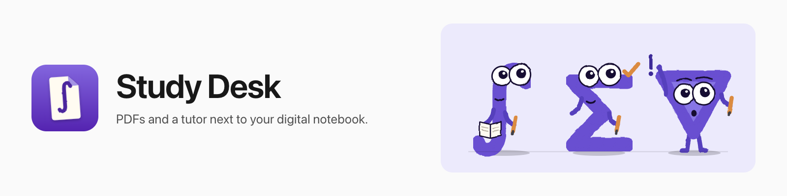
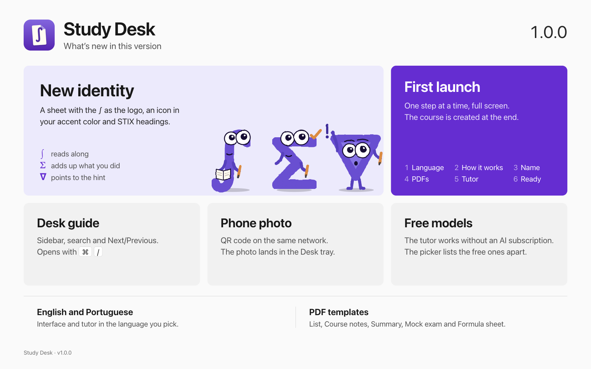

<p align="center"></p>

<p align="center"><a href="README.md">Português</a> · <b>English</b></p>

# Study Desk (Mesa de Estudos)

A local Electron app for studying with PDFs and an AI tutor in the same window. Handwriting stays in [Xournal++](https://xournalpp.github.io/) or another app of your choice; the desk has no ink canvas.

```
Study Desk                              Xournal++ (or another app)
  problem set + formula sheet (PDF)       handwriting
  tutor (OpenCode)                       your attempt
  calculator, GeoGebra, notebook          → Check sends the page to the tutor
```

In Portuguese the app is called **Mesa de Estudos**; the repository and the folders keep that name.

<p align="center"></p>

## What it does

- **Two independent PDF readers** with search, bookmarks, an outline, and clickable "File.pdf, p. N" citations in the tutor's answers.
- **Tutor** with OpenCode, the visible and default engine; provider sign-in happens in the app and the account stays in OpenCode. The Claude Code code remains in the repository for tests and old sessions; Pi is retired, and old sessions open read-only.
- **Check** captures the window of your writing app and attaches it to the message. **Phone photo** shows a QR code that opens a page on the same network, and photos arrive on the desk in the order you sent them.
- **Figures, charts and interactive activities** in the chat, all working offline. GeoGebra on demand, with an optional offline pack.
- **PDF from the tutor:** problem list, handout, summary, mock exam and formula sheet, with an A4 preview and a review step before saving.
- **Notebook** (Review today), study **Statistics**, the **Desk guide** (⌘/) and a numeric calculator.
- **Free** tab for studying without a course; **Create a course** moves the conversation and its PDFs into a new tab.
- Interface and tutor in **English or Portuguese**, light or dark theme (Graphite), and six accent colors.

**Not included:** ink canvas, PDF editing, telemetry, cloud account. Sign-in happens in the app and the provider account stays in OpenCode; the OpenCode Zen free-model key, when used, is encrypted with the system keychain.

## Requirements

- Node **20+**, only to install from source (`npm ci`, `npm run setup`, `npm start`). The app and the tutor MCP server run on Electron's embedded Node, so studying does not depend on the system Node.
- **OpenCode 2.2.4** (the desk installs it on first launch, with a pinned package). The Claude Code code still accepts the 2.1.296 through 2.1 series, but it is not shown in this release; old Pi sessions open read-only.
- Your course PDFs in any folder.
- macOS or Windows. Check works on both; day-to-day use has been tested by hand on macOS.

## Getting started

```sh
cd desk
npm ci
npm run setup
npm run doctor
npm start
```

On first launch the desk walks you through one step at a time: language and color, how the desk works, course name, PDF folder (subfolders count), tutor, and done. The course is only created at the last step. OpenCode asks for your provider sign-in on first connection; the account stays in OpenCode, not in the desk.

`npm run doctor` checks the installed engine, policies, fonts, the visual extension (when applicable) and persistence without opening the app. On a Mac, `npm run install-app` builds **Mesa de Estudos.app**.

For an agent setting up the computer: [`desk/SETUP.md`](desk/SETUP.md) (in Portuguese).

## Updating

**About → Update and restart** (from 0.4.0 on), or `npm run update` in `desk/`. Your `config.json` keeps working as it is. What changed in each version is in the [Releases](https://github.com/FariaDev/mesa-de-estudos/releases).

## Settings

**Settings** (⌘ , / Ctrl+,): courses and folders, readers (one or two, their names and the starting PDF), visible features, appearance, and the app that Check captures. Changes apply when you save. To customize with an agent: [`docs/agents/customizar.md`](docs/agents/customizar.md) and [`desk/config.example.json`](desk/config.example.json).

## Problems

**Report a problem** (the tutor's More options) or `npm run triage` builds a clean report, with no keys, sessions, course names or PDF names, and offers a ready prompt for an agent and a prefilled issue in the public repository [`FariaDev/mesa-de-estudos`](https://github.com/FariaDev/mesa-de-estudos) for you to review. The app log opens from About.

## Development

Code lives in `desk/` (the app), `core/` (invariants in Bend, with laws and proofs) and `visual-check/` (macOS capture). Gates and rules: [`AGENTS.md`](AGENTS.md). Most project docs are in Portuguese.

```sh
cd desk
npm run verify:bend
npm test
npm run ui
```

## Credits

- **Lucas Faria** — author

[MIT](LICENSE) license.
