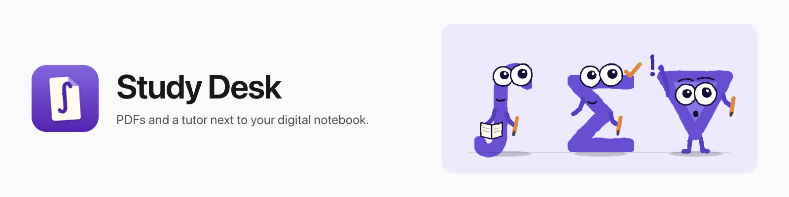
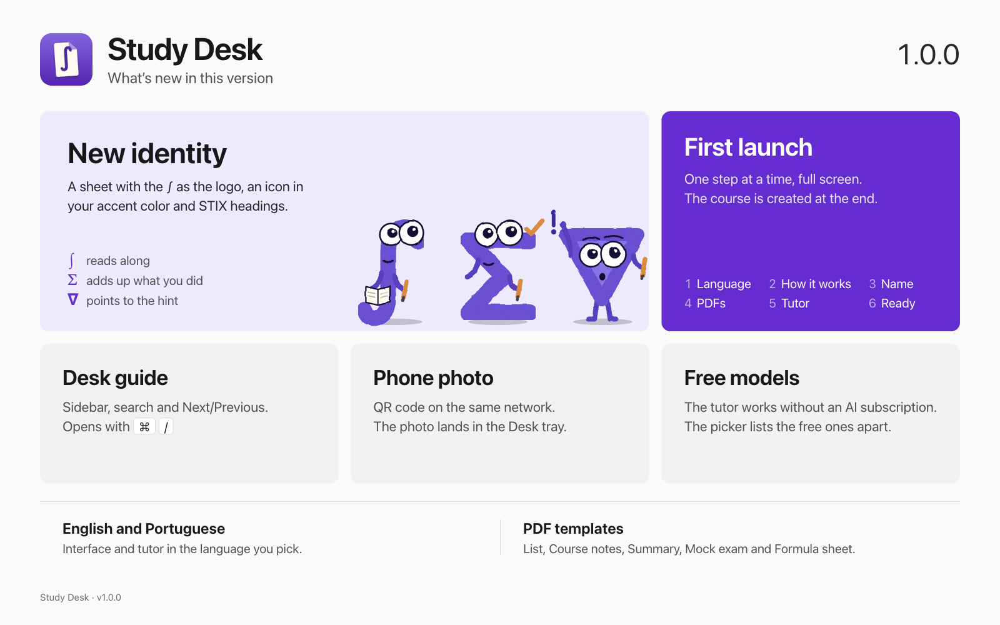

<p align="center"></p>

<p align="center"><a href="README.md">Português</a> · <b>English</b></p>

# Study Desk (Mesa de Estudos)

A local Electron app for studying with PDFs and an AI tutor in the same window. Handwriting stays in [Xournal++](https://xournalpp.github.io/) or another app of your choice; the desk has no ink canvas.

```
Study Desk                              Xournal++ (or another app)
  problem set + formula sheet (PDF)       handwriting
  tutor (Pi, OpenCode or Claude Code)     your attempt
  calculator, GeoGebra, notebook          → Check sends the page to the tutor
```

In Portuguese the app is called **Mesa de Estudos**; the repository and the folders keep that name.

<p align="center"></p>

## What it does

- **Two independent PDF readers** with search, bookmarks, an outline, and clickable "File.pdf, p. N" citations in the tutor's answers.
- **Tutor** with three engines: [Pi](https://github.com/earendil-works/pi), OpenCode and Claude Code (experimental). Free models through OpenCode Zen let you start without an AI subscription.
- **Check** captures the window of your writing app and attaches it to the message. **Phone photo** shows a QR code that opens a page on the same network, and photos arrive on the desk in the order you sent them.
- **Figures, charts and interactive activities** in the chat, all working offline. GeoGebra on demand, with an optional offline pack.
- **PDF from the tutor:** problem list, handout, summary, mock exam and formula sheet, with an A4 preview and a review step before saving.
- **Notebook** (Review today), study **Statistics**, the **Desk guide** (⌘/) and a numeric calculator.
- **Free** tab for studying without a course; **Create a course** moves the conversation and its PDFs into a new tab.
- Interface and tutor in **English or Portuguese**, light or dark theme (Graphite), and six accent colors.

**Not included:** ink canvas, PDF editing, telemetry, cloud account. The desk does not sign in to any provider or store any provider's token.

## Requirements

- Node 22.19+.
- A tutor engine. `npm run setup` installs Pi (tested with 1.3.0). OpenCode and Claude Code are optional and use whatever you already have installed; the accepted Claude Code range is 2.1.296 up to the 2.1 series.
- Your course PDFs in any folder.
- macOS or Windows. Check works on both; day-to-day use has been tested by hand on macOS.

## Getting started

```sh
cd desk
npm ci
npm run setup
npm run doctor
npm start
```

On first launch the desk walks you through one step at a time: language and color, how the desk works, course name, PDF folder (subfolders count), tutor, and done. The course is only created at the last step. Pi asks for your provider credentials on first connection; they stay in Pi, not in the desk.

`npm run doctor` checks Pi, policies, fonts, the visual extension and persistence without opening the app. On a Mac, `npm run install-app` builds **Mesa de Estudos.app**.

For an agent setting up the computer: [`desk/SETUP.md`](desk/SETUP.md) (in Portuguese).

## Updating

**About → Update and restart** (from 0.4.0 on), or `npm run update` in `desk/`. Your `config.json` keeps working as it is. What changed in each version is in the [Releases](https://github.com/FariaDev/mesa-de-estudos/releases).

## Settings

**Settings** (⌘ , / Ctrl+,): courses and folders, readers (one or two, their names and the starting PDF), visible features, appearance, and the app that Check captures. Changes apply when you save. To customize with an agent: [`docs/agents/customizar.md`](docs/agents/customizar.md) and [`desk/config.example.json`](desk/config.example.json).

## Problems

**Report a problem** (the tutor's More options) or `npm run triage` builds a clean report, with no keys, sessions, course names or PDF names, and offers a ready prompt for an agent and a prefilled GitHub issue for you to review. The app log opens from About.

## Development

Code lives in `desk/` (the app), `core/` (invariants in Bend, with laws and proofs) and `visual-check/` (macOS capture). Gates and rules: [`AGENTS.md`](AGENTS.md). Most project docs are in Portuguese.

```sh
cd desk
npm run verify:bend
npm test
npm run ui
```

## Credits

- **Lucas Faria** — author

[MIT](LICENSE) license.
