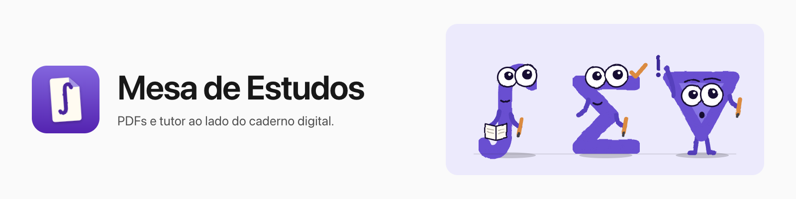
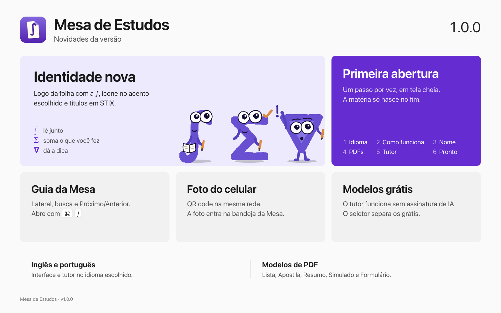

<p align="center"></p>

<p align="center"><b>Português</b> · <a href="README.en.md">English</a></p>

# Mesa de Estudos

App local (Electron) para estudar com PDFs e um tutor de IA na mesma janela. A escrita à mão continua no [Xournal++](https://xournalpp.github.io/) ou em outro programa de sua escolha; a Mesa não tem canvas de tinta.

```
Mesa de Estudos                         Xournal++ (ou outro)
  enunciado + formulário (PDF)            escrita à mão
  tutor (Pi, OpenCode ou Claude Code)     tentativa
  calculadora, GeoGebra, caderno          → Conferir manda a página ao tutor
```

Em inglês o app se chama **Study Desk**.

<p align="center"></p>

## O que tem

- **Dois leitores de PDF** independentes, com busca, favoritos, sumário e citação "Arquivo.pdf, p. N" clicável nas respostas.
- **Tutor** com três motores: [Pi](https://github.com/earendil-works/pi), OpenCode e Claude Code (experimental). Modelos grátis pelo OpenCode Zen: dá para começar sem assinatura de IA.
- **Conferir:** captura a janela do programa de escrita e anexa à mensagem. **Foto do celular:** um QR code abre uma página na mesma rede, e as fotos entram na Mesa na ordem de envio.
- **Figuras, gráficos e atividades interativas** no chat, que funcionam offline. GeoGebra sob demanda, com pacote offline opcional.
- **PDF pelo tutor:** Lista, Apostila, Resumo, Simulado e Formulário, com prévia em A4 e revisão antes de salvar.
- **Caderno** (Revisar hoje), **Estatísticas** de estudo, **Guia da Mesa** (⌘/) e calculadora numérica.
- **Aba Livre** para estudo avulso, sem criar matéria; **Criar matéria** leva a conversa e os PDFs para uma aba nova.
- Interface e tutor em **português ou inglês**, tema claro ou escuro (Grafite) e seis cores de acento.

**Não entra:** canvas de tinta, edição de PDF, telemetria, conta na nuvem. A Mesa não faz login nem guarda token de nenhum provedor.

## Requisitos

- Node 22.19+.
- Um motor de tutor. O `npm run setup` instala o Pi (testado com o 1.3.0). O OpenCode e o Claude Code são opcionais e usam o que você já tem instalado; o Claude Code aceito vai de 2.1.296 até a série 2.1.
- Os PDFs da matéria numa pasta qualquer.
- macOS ou Windows. O Conferir funciona nos dois; o resto do dia a dia foi testado à mão no macOS.

## Começar

```sh
cd desk
npm ci
npm run setup
npm run doctor
npm start
```

Na primeira abertura, a Mesa mostra um passo por vez: idioma e cor, como a Mesa funciona, nome da matéria, pasta de PDFs (subpastas contam), tutor e pronto. A matéria só é criada no último passo. O Pi pede as credenciais do provedor na primeira conexão, e elas ficam no Pi, não na Mesa.

`npm run doctor` confere Pi, políticas, fontes, extensão visual e persistência sem abrir o app. No Mac, `npm run install-app` monta o **Mesa de Estudos.app**.

Para um agente configurar o computador: [`desk/SETUP.md`](desk/SETUP.md).

## Atualizar

**Sobre → Atualizar e reiniciar** (de 0.4.0 em diante), ou `npm run update` em `desk/`. O `config.json` continua valendo como está. O que mudou em cada versão fica nas [Releases](https://github.com/FariaDev/mesa-de-estudos/releases).

## Configurações

**Ajustes → Configurações** (⌘ , / Ctrl+,): matérias e pastas, leitores (um ou dois, nomes e PDF inicial), recursos visíveis, aparência e o programa do Conferir. As mudanças valem ao salvar. Para personalizar com um agente: [`docs/agents/customizar.md`](docs/agents/customizar.md) e [`desk/config.example.json`](desk/config.example.json). O uso e os dados locais estão em [`desk/README.md`](desk/README.md).

## Problemas

**Relatar um problema** (Mais opções do tutor) ou `npm run triage` monta um relatório limpo, sem chaves, sessões, nomes de matéria nem de PDF, e oferece um prompt pronto para um agente e a issue já preenchida para você revisar. O log do app abre no Sobre.

## Desenvolvimento

Código em `desk/` (app), `core/` (invariantes em Bend, com leis e provas) e `visual-check/` (captura no macOS). Portões e regras: [`AGENTS.md`](AGENTS.md).

```sh
cd desk
npm run verify:bend
npm test
npm run ui
```

## Créditos

- **Lucas Faria** — autor

Licença [MIT](LICENSE).
