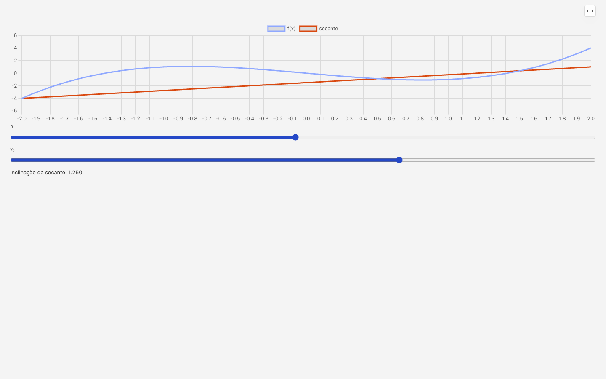
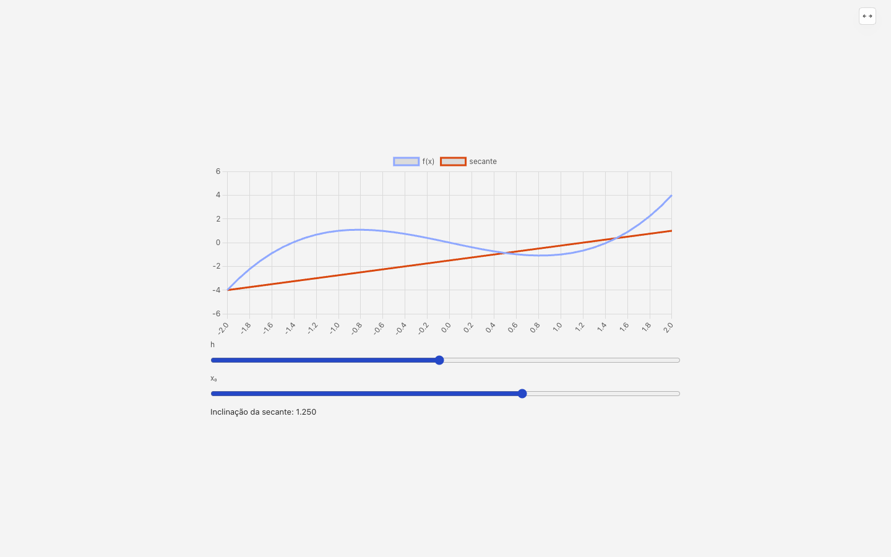
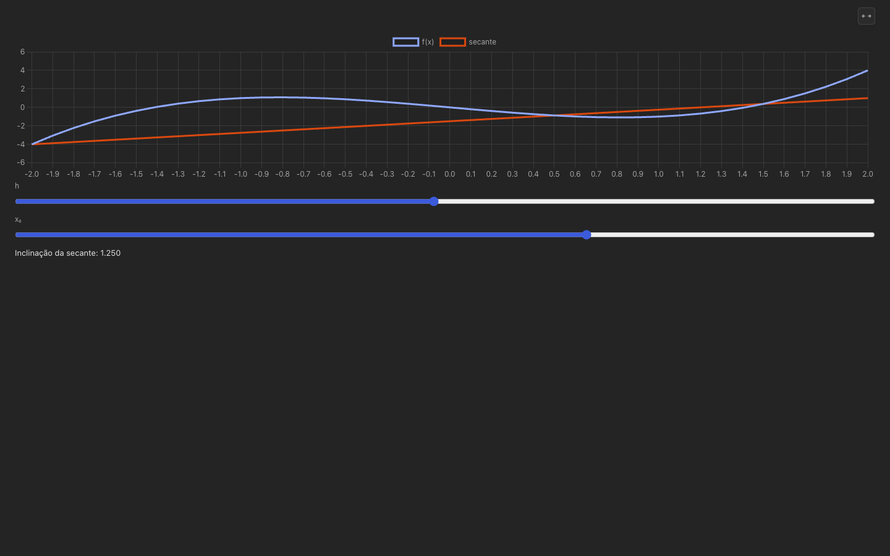
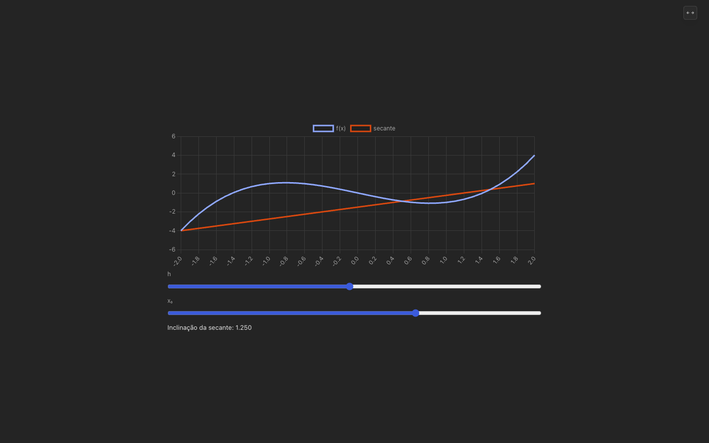
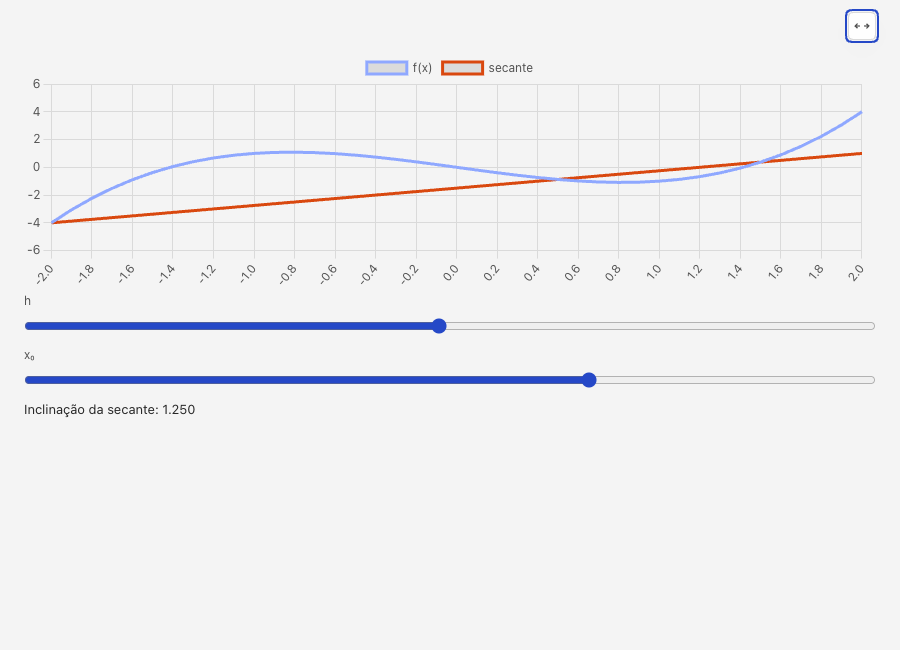
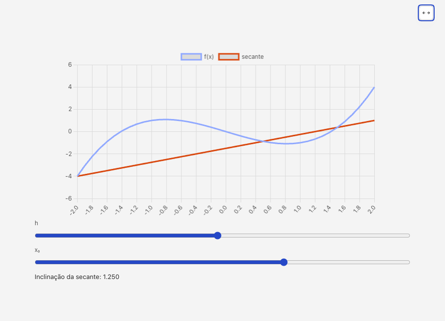
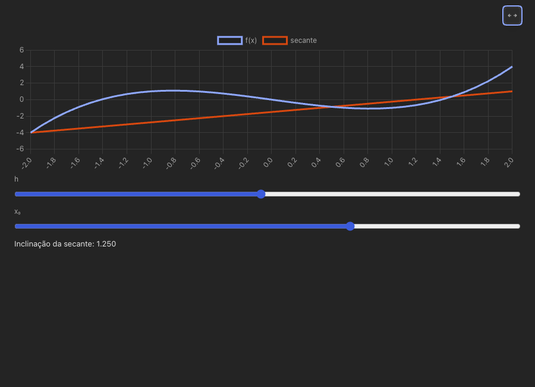
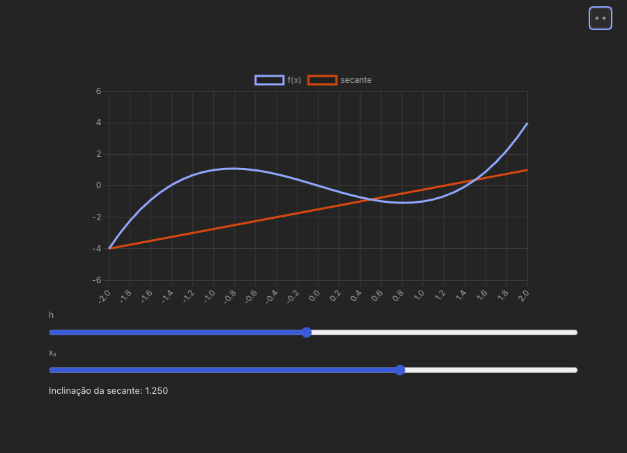

# Atividade: persistência ao reabrir e tela cheia de conteúdo misto

Relato do autor (2026-10-20), versão instalada, aba de estudo: o tutor publicou
pela `criar_atividade` um gráfico interativo (Chart.js, com controles
arrastáveis de h e x₀).

1. Ao fechar e abrir a Mesa, o quadro sumiu da conversa.
2. A tela cheia desse quadro deixava tudo enorme e solto, sem largura de leitura.

As fixtures usam funções inventadas (f(x) = x³ − 2x, g(x) = 2x + 1). A captura
do autor não foi copiada.

## 1. O quadro some ao reabrir

### Como o quadro volta

O renderer não guarda o quadro: ao carregar o histórico, `historyTurns`
(`desk/src/worklog.mjs`) cria uma parte `artifact` para cada chamada de
`criar_atividade` no histórico. O `chat.mjs` põe o slot
`.activity-slot[data-activity-call=<toolCallId>]` nesse ponto, e o
`activity.mjs` acha no store o item com o mesmo `toolCallId` e lê o estado
salvo. **Sem a chamada da ferramenta no histórico reaberto, o slot não nasce e
o quadro some**, mesmo com o store intacto.

### Suspeitos, um por um

| Suspeito | Resultado |
|---|---|
| `activity-store.cjs` não salvou | Descartado. O item, o documento e o `state.json` estão no disco nos três motores (teste abaixo). |
| restauração não refaz o quadro (nativos × Pi) | **Causa, no OpenCode.** `normalizeHistory` (`desk/src/agents/opencode-history.cjs`) só aproveitava `text` e `reasoning` e jogava fora as partes `tool` do v2 (`SessionMessageAssistantTool` no SDK oficial: `{type:'tool', id, name, state:{status, input, content}}`). O `NativeService` troca o cache pelo histórico do servidor no `get_messages`, e o cache do OpenCode também não tem as chamadas (o `message_end` dele só leva texto). Claude e Pi trazem a chamada (`tool_use` → `toolCall` no Claude; JSONL no Pi). |
| hash e versão não batem | Descartado. Mesmo hash e mesma versão depois de reabrir, nos três. |
| `heights` ou `kind` se perdem | Descartado. `view: 'visualizacao'` e os pares de `heights` voltam iguais. |
| sessão aberta pelo cabeçalho × pelo histórico | Descartado. Os dois caminhos põem o mesmo `session` no escopo do main (`openSessionWithinNav`), e o `conversationId` do store é esse caminho. |

### Teste de regressão

`desk/tests/activity-reopen.test.mjs` passa pela mesma cadeia do app nos três
motores: o fake do motor devolve o histórico pelo serviço real, `historyTurns`
monta os turnos, e o store responde `list` e `stateGet`. O teste exige o slot
do quadro, o mesmo hash e a mesma versão, `kind`, `heights` e o estado salvo
(`{h: 0.25, x0: 1.5}`).

- **Pi:** `tests/fake-pi.mjs` lê o JSONL e responde `get_messages`.
- **Claude:** `ClaudeAdapter` + `ClaudeService` com o SDK falso
  (`tests/claude-fixtures.mjs`) e histórico nativo com `tool_use`/`tool_result`.
- **OpenCode:** turno real contra `tests/fake-opencode.mjs`; o id é o do
  `tool.called` do SSE, o mesmo que a ponte reivindica. Depois o serviço é
  fechado e aberto de novo com o mesmo `ses_`.

Antes do conserto: Pi ✔, Claude ✔, **OpenCode ✖**
(`o histórico reaberto tem o slot do quadro ([]) — 0 !== 1`). Depois: os três ✔.

O fake do OpenCode passou a gravar a parte `tool` na mensagem do assistente,
como o servidor v2 faz. Sem isso, o histórico do fake não tinha o que o real
tem. `tests/opencode-files.test.mjs` cobre o parser: `completed` vira
`toolCall` + `toolResult`, `error` vira `toolResult` com `isError`, e
`pending` (entrada ainda em texto) fica só como chamada.

### Conserto

`normalizeHistory` agora transforma a parte `tool` em `toolCall`, com
`arguments` igual ao `state.input`. Quando a ferramenta terminou, ele também
cria uma mensagem `toolResult` com o mesmo id, no formato do Pi que o
`historyTurns` já pareia.

### Por que fica em JS e não no núcleo (ADR 0001)

A persistência é dado do aluno, mas ela estava certa: o store em
`activity-store.cjs` guardava tudo. O que falhava era traduzir o formato de
fio de um motor para o formato de exibição, trabalho de adaptador de I/O. A
regra de domínio ("atividade publicada volta ao reabrir, com o estado") está
fixada pelo teste de ponta a ponta nos três motores. Não há invariante novo
para provar em Bend.

### Risco que fica

Se o `tool.called` do SSE não chegar a tempo, a ponte do OpenCode publica
com um id próprio `opencode-mcp:…` (`opencode-activity-calls.cjs`). Esse id
não existe em nenhum histórico, então o quadro não teria slot nem ao vivo nem
ao reabrir. O comentário do arquivo diz que o quadro "aparece solto", mas o
renderer só hidrata slots existentes. Não mexi nisso: é outro caminho, e o
`desk.log` registra o aviso.

## 2. Tela cheia de conteúdo misto

### Antes

A #52 só tratava o quadro que é só figura. Com gráfico, controles e texto, o
documento seguia o próprio layout na largura da janela inteira, e os sliders
iam de ponta a ponta. O contêiner do gráfico tem altura fixa (240 px), como o
tutor costuma fazer, e só a largura crescia: o gráfico ficava 1,9× a 2,3× mais
achatado (medidas abaixo).

### Desenho

Tudo no documento do quadro (`desk/activity-page-script.cjs`), em regras
`:where()` do `HOST_CSS` que só valem com `data-display=fullscreen` e sem
`data-figure=on`:

- **Largura de leitura:** `#mesa-activity-root` com `width:min(100%,760px)`,
  centralizado. O `html` vira grid com `align-content:safe center`: conteúdo
  curto fica no meio da tela, e conteúdo longo começa no topo e rola, sem
  corte.
- **Proporção estável:** a cada medição de altura fora da tela cheia, o quadro
  marca o contêiner de cada gráfico do Chart.js (`data-mesa-ratio`,
  `--mesa-ratio`). Na tela cheia, esse contêiner usa `aspect-ratio` com a
  proporção do quadro, até `60vh` de altura. A proporção não é lida na
  entrada: quando o `displayMode` chega, o iframe já pode estar no tamanho
  novo. Ao sair, volta a altura do autor.
- **Texto e controles no tamanho normal:** nenhuma regra mexe em fonte, zoom
  ou escala.
- **Margem e fundo:** sem mudança. O palco da tela cheia usa `var(--side)` e o
  documento usa `--mesa-bg`, o fundo da coluna nos dois temas.
- **Saída:** pelo botão e pelo Esc, como antes. O teste agora exercita os dois.

### Medição (teste de janela)

`tests/activity-viz-ui.mjs` ganhou o caso misto (`Mostre a secante.` no Pi
sintético `tests/fixtures/mesa-interactive-pi.mjs`), nos dois temas, em
1440×900 e 900×650. O teste exige:

- raiz ≤ 760 px e centralizada;
- proporção do gráfico igual à do quadro (±3%), com o gráfico inteiro na tela;
- tamanho do texto, do rótulo e do slider igual ao do quadro;
- fundo do documento e margem iguais ao fundo da coluna;
- nada cortado em cima;
- saída pelo botão (tema claro) e pelo Esc (tema escuro), com o gráfico de
  volta aos 240 px do autor.

Medido na janela, com o mesmo teste. Para o "antes", só o
`activity-page-script.cjs` voltou ao commit anterior (`ed7b17b`), numa cópia
temporária do teste que registra as medições em vez de falhar. Os valores são
iguais nos dois temas:

| Janela | | Coluna (raiz) | Contêiner do gráfico | Proporção (quadro → tela cheia) | Texto |
|---|---|---|---|---|---|
| 1440×900 | antes | 1392 px (janela toda) | 601×240 → 1392×240 | 2,50 → **5,80** | 13 px |
| 1440×900 | depois | 760 px, centralizada | 601×240 → 760×304 | 2,50 → **2,50** | 13 px |
| 900×650 | antes | 852 px (janela toda) | 447×240 → 852×240 | 1,86 → **3,55** | 13 px |
| 900×650 | depois | 760 px, centralizada | 447×240 → 641×344 | 1,86 → **1,86** | 13 px |

Fundo do documento, margem da tela cheia e coluna têm a mesma cor nos dois
temas e nos dois tamanhos: `rgb(244, 244, 244)` no claro e `rgb(36, 36, 36)`
no escuro. Em 900×650 o gráfico fica mais estreito que os sliders, porque o
teto de `60vh` mantém o gráfico e os controles inteiros na tela.

Capturas (Pi sintético, função inventada) em
[`atividade-tela-cheia/`](atividade-tela-cheia/):

| | Antes | Depois |
|---|---|---|
| 1440×900 claro |  |  |
| 1440×900 escuro |  |  |
| 900×650 claro |  |  |
| 900×650 escuro |  |  |

## Portões (em `desk/`)

| Portão | Resultado |
|---|---|
| `MESA_GATE_CACHE=0 npm test` (typecheck, lint e `tests/*.test.mjs`) | ✔ 1918/1918 |
| `node tests/native-activity-tool.mjs` | ✔ |
| `npm run ui -- activity` (card, concurrency, figure, preview, ggb-overlay, viz) | ✔ 6/6 |
| `npm run ui -- mesa-interactive` (usa o fixture alterado) | ✔ |
| `hunt-activity-ui`, `hunt-activity-network`, `hunt-activity-isolation` | ✔ |
| arquivos de `rg -l "FAKE_PI\|fakePiSource" tests` | não se aplica: `tests/fake-pi.mjs` não mudou |
| `npm run test:claude-ui` | não se aplica: o caminho do Claude não mudou |

Nenhum "could not create image from window".

Pronto para integrar.
