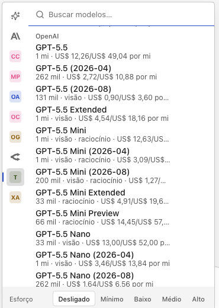
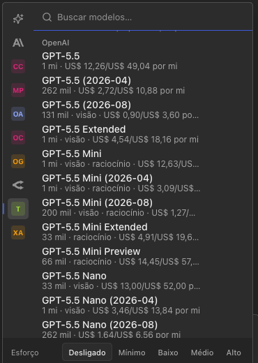
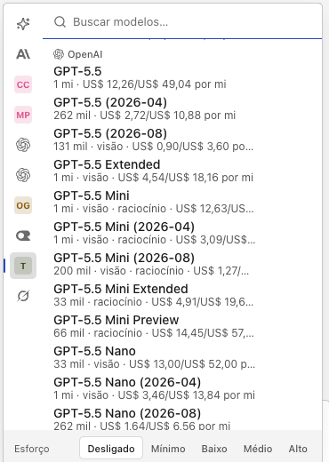
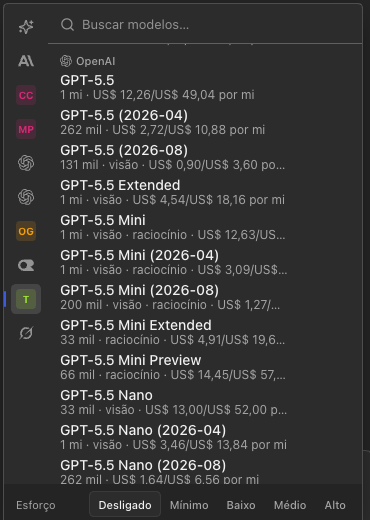
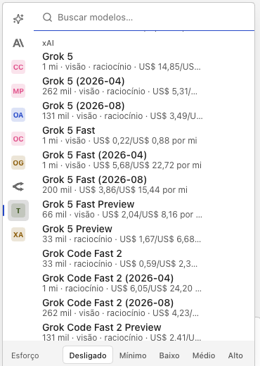
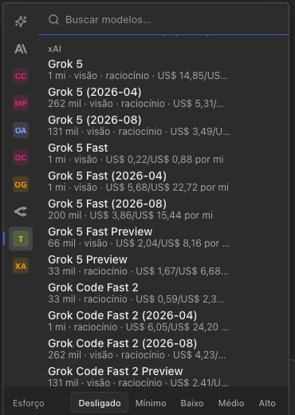
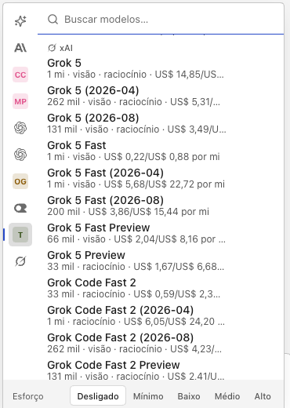
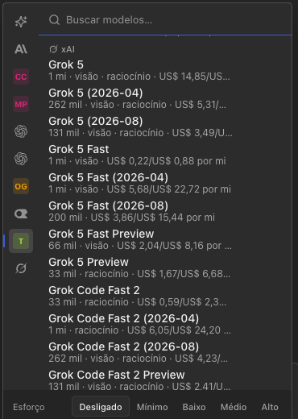

# Logos dos fabricantes no seletor de modelo: resultado

Pedido: os logos dos fabricantes têm de aparecer no seletor de modelo, a começar pelo da OpenAI. Antes havia só 8 caminhos do Simple Icons 16.35.0, e OpenAI, xAI, Groq, Cerebras, Amazon, Azure, Z.AI e MiniMax caíam no monograma.

## Fonte: Lobe Icons 1.95.1, fonte única

- O pacote é o `@lobehub/icons-static-svg@1.95.1`, publicado em 2026-09-21. É a versão estável mais recente e já tem mais de duas semanas.
- Baixei com `npm pack` numa pasta vazia do scratchpad e só li os SVGs. Nenhum script do pacote rodou, e ele não entrou no `package.json`.
- **Licença:** o `package.json` do pacote diz `"license": "MIT"`, mas o tarball não traz o arquivo LICENSE. O LICENSE do repositório (github.com/lobehub/lobe-icons) é MIT, "Copyright (c) 2023 LobeHub".
- **Variantes:** usei só as monocromáticas, as sem `-color`, `-text` ou `-brand`. Um script no scratchpad extraiu os `d` de cada `<path>` e checou duas coisas: nenhum SVG tem forma além de `<path>` e nenhum tem cor fixa (todos usam `currentColor`).
- **Fonte única:** o Lobe tem os 8 logos que vinham do Simple Icons. Por isso ele ficou como fonte única e o Simple Icons saiu. Muda o desenho de dois logos:
  - o do OpenRouter, porque o do Lobe é o logo atual da marca;
  - o do Hugging Face, num traço mais simples.
- **Crédito no Sobre:** troquei o crédito do Simple Icons por `about.credit.lobeIcons`, em pt-BR e em en: "Lobe Icons 1.95.1 — logos dos provedores e dos fabricantes no seletor de modelo, embutidos e offline (MIT, © 2023 LobeHub, github.com/lobehub/lobe-icons; as marcas são dos donos)". O `about-ui.mjs` confere essa linha.
- **Sem redesenho:** nada foi redesenhado nem colorido. Dois logos guardam detalhes do original:
  - o Azure mantém as opacidades (0,5 e 0,75);
  - a Nova da Amazon mantém o `viewBox` 33×32 e o preenchimento `nonzero`.

## Cobertura

| Marca | Slug do Lobe | Provedor (trilho / segunda linha) | Prefixo do OpenRouter (subgrupo) |
|---|---|---|---|
| OpenAI | `openai` | `openai`, `openai-codex` | `openai/` |
| xAI (logo do Grok, a pedido do autor) | `grok` | `xai` | `x-ai/` |
| Meta (Llama) | `meta` | `llama` | `meta-llama/` |
| Qwen / Alibaba | `qwen`, `alibaba` | `alibaba` → `qwen` | `qwen/`, `alibaba/` |
| Moonshot (Kimi) | `moonshot` | `moonshotai` | `moonshotai/` |
| Z.AI / Zhipu (GLM) | `zai`, `zhipu` | `zai`, `zhipuai` | `z-ai/`, `thudm/` |
| MiniMax | `minimax` | `minimax` | `minimax/` |
| Groq | `groq` | `groq` | — |
| Cerebras | `cerebras` | `cerebras` | — |
| Amazon (Bedrock / Nova) | `bedrock`, `nova` | `amazon-bedrock` | `amazon/` → Nova |
| Microsoft / Azure | `microsoft`, `azure` | `azure-openai-responses`, `azure` | `microsoft/` |
| Cohere | `cohere` | `cohere` | `cohere/` |
| Perplexity | `perplexity` | `perplexity` | `perplexity/` |
| NVIDIA | `nvidia` | `nvidia` | `nvidia/` |
| Nous Research | `nousresearch` | — | `nousresearch/` |
| Liquid | `liquid` | — | `liquid/` |
| Inception | `inception` | `inception` | `inception/` |
| Anthropic, Google, Google Cloud, OpenCode, OpenRouter, Mistral, DeepSeek, Hugging Face (os de antes) | mesmos nomes; `mistral` | os de antes | `anthropic/`, `google/`, `mistralai/`, `deepseek/` |
| GitHub Copilot | `githubcopilot` | `github-copilot` | — |
| AI21, Arcee, Baidu, ByteDance, IBM, Tencent (extras do catálogo do fake) | mesmos nomes | — | `ai21/`, `arcee-ai/`, `baidu/`, `bytedance/`, `ibm-granite/`, `tencent/` |

- Os ids de provedor além dos do Pi (`moonshotai`, `zhipuai`, `alibaba`, `nvidia`, `cohere`, `perplexity`, `inception`, `azure`, `llama`) seguem o models.dev, de onde vem o catálogo do OpenCode.
- **GitHub Copilot:** no Simple Icons ele ficava de fora por ter licença própria (Primer). O Lobe o distribui sob MIT.
- **Monograma:** o OpenCode Go continua com monograma de propósito, para não repetir no trilho o chip do OpenCode Zen. Commandcode, provedores desconhecidos e fabricantes sem logo (Sao10K, TheDrummer, Elorian…) também ficam com o monograma.
- **OpenAI Codex:** usa o mesmo logo do OpenAI, por decisão do autor (2026-10-21). Quem tiver os dois provedores vê dois chips iguais no trilho; a dica e o nome acessível distinguem os dois.

## Onde aparecem

- **Trilho e segunda linha dos grupos mistos:** `providerIcon(provider, name)`, como antes, agora com o mapa maior.
- **Subgrupo por fabricante:** `vendorIcon(modelId, vendor)` lê o prefixo do id do primeiro modelo do subgrupo (`x-ai/grok-5` → `grok`).
  - Sem logo, o subgrupo mostra o monograma do nome do fabricante; o subgrupo sem fabricante fica só com o texto.
  - O nome foi para um ``, e o logo fica no `.model-section-logo`, com 12 px, o mesmo tamanho do logo da linha.
- Tudo é monocromático, em `currentColor`, e nada é buscado na rede.

Arquivos: `desk/src/provider-icons.mjs` (239 linhas, com os caminhos), `desk/src/model-picker-rows.mjs`, `desk/src/model-picker.css`, `desk/index.html` e `desk/locales/*.json`. Não mexi em `desk/icons.mjs` nem em `desk/config.cjs`.

## Testes

- **`tests/provider-icons.test.mjs`:** reescrito, com 9 testes. Cobre:
  - o mapa de ids de provedor e o de prefixos de fabricante, tabela por tabela;
  - que todo slug mapeado (`mappedIconSlugs`) tem caminho e vira um SVG só de `<path>` em `currentColor`;
  - as opacidades do Azure e o `viewBox` da Nova;
  - o monograma de quem não tem logo;
  - a ausência de endereço de rede e de cor fixa no arquivo.
- **`tests/model-picker-ui.mjs`:** o trilho espera o logo `openai` para a OpenAI e o `grok` para o xAI.
- **`tests/model-picker-catalog-ui.mjs`:**
  - os chips do usuário esperam o logo do OpenAI Codex e do xAI, e o monograma do OpenCode Go e do Command Code;
  - os subgrupos do OpenRouter esperam o logo de 14 fabricantes e o monograma "SK" do Sao10K, com o logo em 12 px;
  - com `MESA_REVIEW_SHOTS`, ele tira também as capturas dos subgrupos OpenAI e xAI.
- **`tests/about-ui.mjs`:** confere o crédito novo.

## Portões

- `MESA_GATE_CACHE=0 npm test`: 1922 testes, 0 falhas (typecheck incluído), rodado de novo depois da última mudança.
  - O worktree não tinha `node_modules`. Como o `package.json` e o `package-lock.json` são iguais aos do checkout principal, liguei um symlink para o `node_modules` de lá.
  - Não rodei `npm ci`, `setup`, `update` nem `install-app`.
- `npm run ui -- model-picker,model-indicator,free-models`: 5 ok, 0 falhas. Depois da captura extra, `npm run ui -- model-picker` deu 2 ok.
- `npm run ui -- about`: 1 ok.

## Capturas

As capturas usam o catálogo do Pi de mentira (`FAKE_PI_MANY_MODELS=450`), sem material de curso, recortadas na caixa do seletor. Estão em `docs/reviews/logos-fabricantes-seletor/`. O "antes" saiu de uma cópia do HEAD `e61b563` no scratchpad.

| | claro | escuro |
|---|---|---|
| OpenAI, antes |  |  |
| OpenAI, depois |  |  |
| xAI, antes |  |  |
| xAI, depois |  |  |

- **No trilho:** "OA", "OC" e "XA" viraram os logos da OpenAI (duas vezes: OpenAI e OpenAI Codex) e do Grok.
- **No subgrupo:** o subtítulo "OpenAI" / "xAI" ganhou o logo à esquerda.
- **OpenRouter:** o logo novo do Lobe aparece no lugar do antigo.

## O que fica de fora

- Nada foi commitado, nem houve push, PR ou issue fechada.
- A #61 (identidade) pode redesenhar os ícones da Mesa. Os logos de marca deste trabalho ficam no `provider-icons.mjs`, separados do `icons.mjs`.
